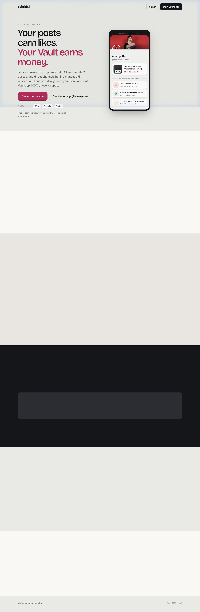
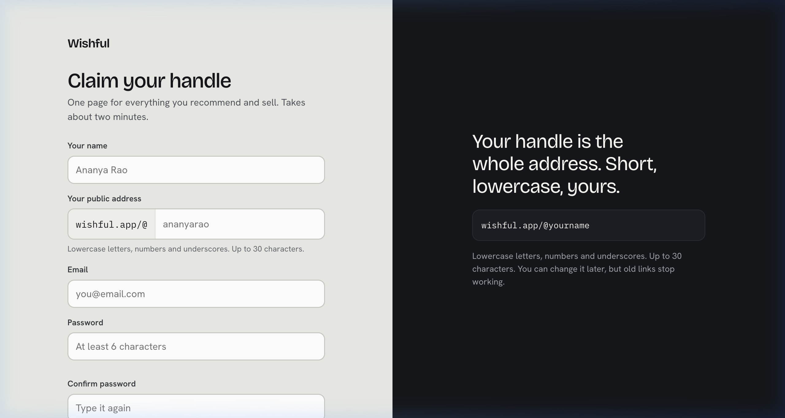
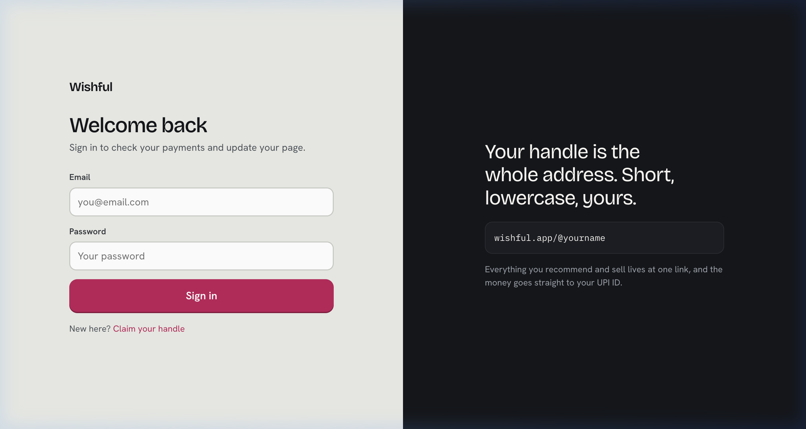
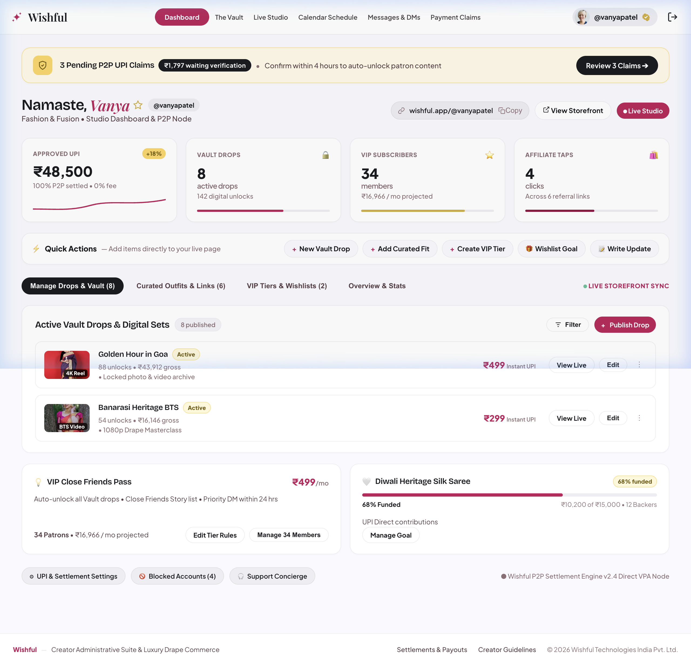
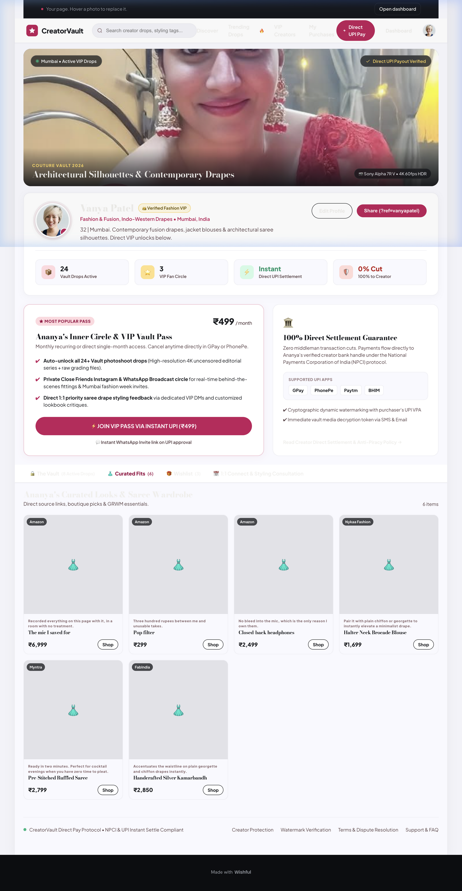
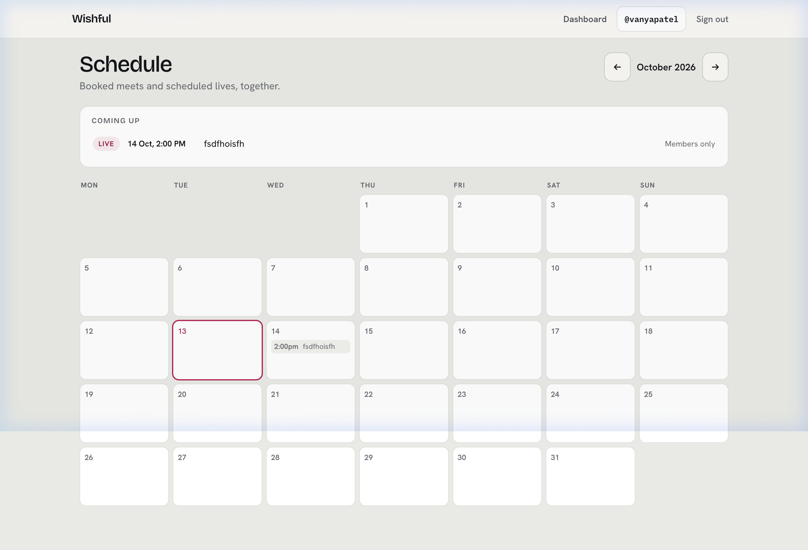
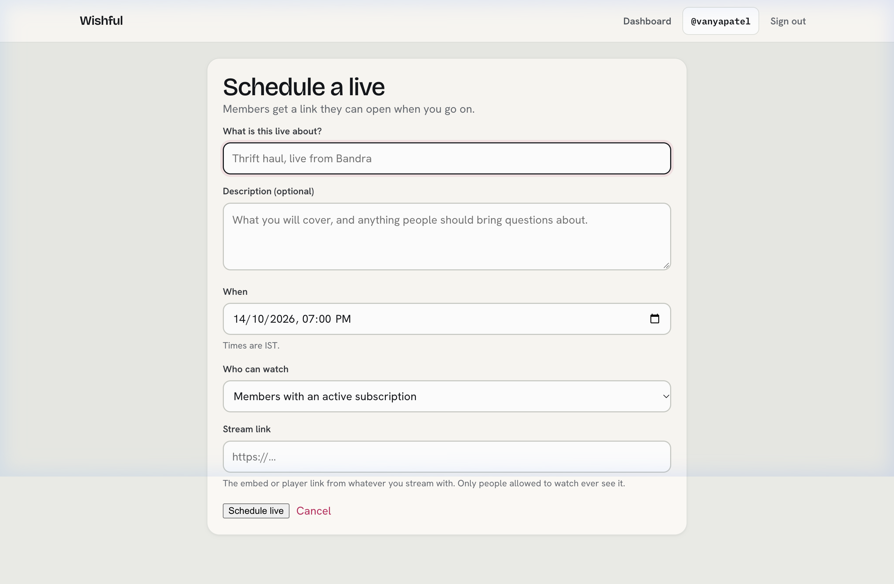
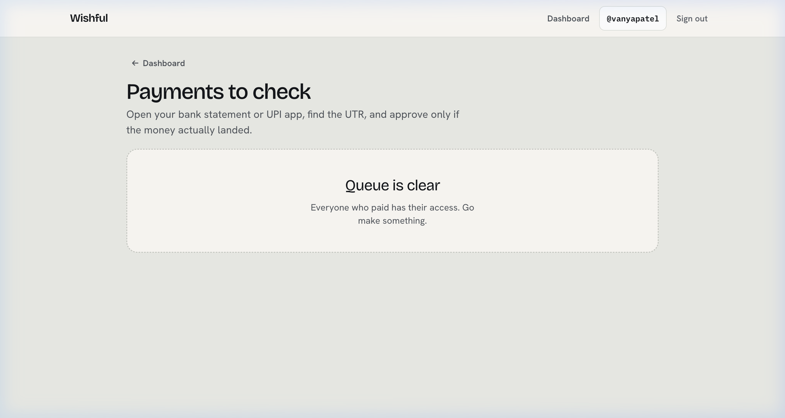
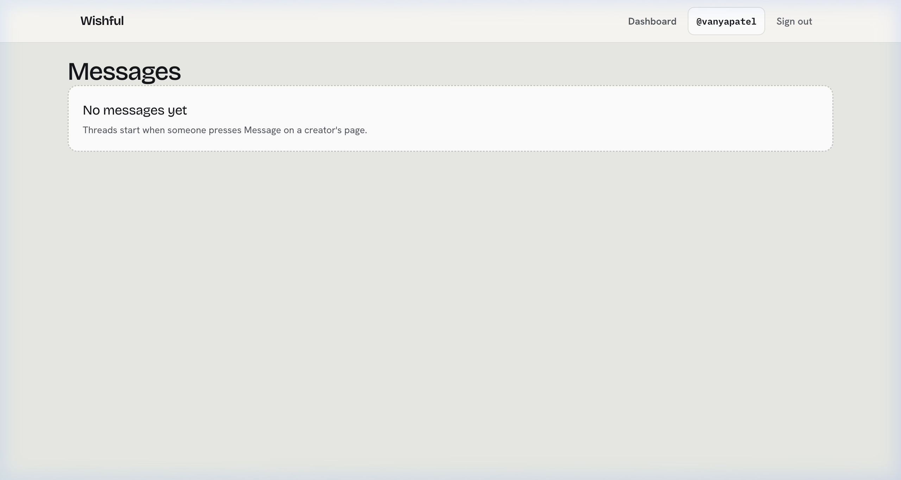
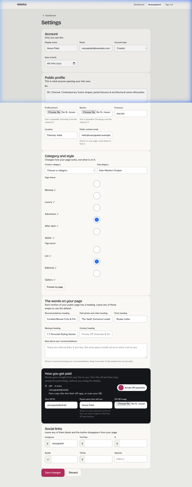

# Wishful — Design System & Visual Reference

> **Superseded on 13 Oct 2026.** The app now uses the dark "Studio" design system in `public/assets/wf.css` (see `REFERENCE.md` §4 and `docs/screenshots/redesign-2026-10/`). This document describes the previous light theme and is kept for history.

> **Last Updated:** 13 Oct 2026
>
> This document captures the complete design system, visual language, page screenshots, and responsive layout specifications for **Wishful** — an Indian creator monetization platform.

---

## Table of Contents

1. [Brand Identity](#1-brand-identity)
2. [Color System](#2-color-system)
3. [Typography](#3-typography)
4. [Spacing & Layout](#4-spacing--layout)
5. [Elevation & Depth](#5-elevation--depth)
6. [Shape System](#6-shape-system)
7. [Component Library](#7-component-library)
8. [Responsive Viewport Standards](#8-responsive-viewport-standards)
9. [Page Screenshots](#9-page-screenshots)
10. [CSS Architecture](#10-css-architecture)

---

## 1. Brand Identity

### Visual Aesthetic: Indian Modern Editorial Chic

Wishful blends contemporary high-fashion editorial rigor with vibrant Indian sartorial luxury. Tailored for mobile-first creator monetization within Indian fashion, saree draping, glamour, and style curations, the aesthetic moves away from kitsch toward **quiet opulence**, warm alabaster surfaces, sharp typography, and jewel-tone accents.

**Design Philosophy:**
- **Modern Editorial Luxury:** Inspired by international luxury publications and contemporary Indian couture ateliers (Sabyasachi, Raw Mango, Tarun Tahiliani), combining pristine typography with generous breathing room.
- **Warm Architectural Minimalism:** Light, alabaster-infused canvas layers provide a soft, tactile editorial foundation that lets vivid textile photography, silks, and zari work take center stage.
- **Glass & Luster Accents:** Subtle translucent scrims, brushed gold metallic tier badges, and high-impact ruby/crimson CTA triggers elevate micro-transactions into premium patronage experiences.

### Logo & Branding
- **Icon:** 3-sparkle constellation SVG in Sindoor Ruby (`#C2185B`) — represents creative energy and aspiration.
- **Wordmark:** `Wishful` in serif typeface (Playfair Display, 21px, weight 700, letter-spacing -0.01em, Kajal Charcoal color).
- **Dashboard Wordmark:** Same serif `Wishful` without any `PORTAL` or status indicators — clean and decluttered.

---

## 2. Color System

The palette balances modern restraint with rich subcontinental color theory.

### Core Brand Colors

| Token | Name | Hex | Usage |
|-------|------|-----|-------|
| `--cp-ruby` | Sindoor Ruby | `#C2185B` | Primary actions, active tabs, unlock states, CTA buttons, priority micro-interactions |
| `--cp-gold` | Zari Gold | `#D4AF37` | VIP membership badges, verified checkmarks, ceremonial tier indicators |
| `--cp-jamun` | Deep Jamun / Velvet Maroon | `#7A1C3C` | Deep container tints, elevated tags, gradient borders on exclusive drops |
| `--cp-charcoal` | Kajal Charcoal | `#111317` | Primary text, high-contrast elements against backdrop |
| Canvas | Raw Alabaster Silk | `#F6F7F5` / `#F9F9FF` | Off-white gallery-grade foundation, reduces screen glare |

### Extended Surface System

| Token | Hex | Usage |
|-------|-----|-------|
| `surface` | `#F9F9FF` | Base canvas |
| `surface-dim` | `#D9D9DF` | Dimmed background |
| `surface-container-lowest` | `#FFFFFF` | Card backgrounds |
| `surface-container-low` | `#F3F3F9` | Subtle section backgrounds |
| `surface-container` | `#EDEDF3` | User pills, chips |
| `surface-container-high` | `#E8E8ED` | Hover states |
| `on-surface` | `#1A1C20` | Text on surface |
| `on-surface-variant` | `#594045` | Secondary text |
| `outline` | `#8D6F75` | Borders |
| `outline-variant` | `#E1BEC4` | Subtle borders |

### Semantic Colors

| Token | Hex | Usage |
|-------|-----|-------|
| `primary` | `#9B0044` | Deep primary |
| `primary-container` | `#C2185B` | Primary containers |
| `secondary` | `#735C00` | Secondary actions |
| `secondary-container` | `#FED65B` | Gold containers |
| `tertiary` | `#892847` | Tertiary accents |
| `error` | `#BA1A1A` | Error states |

---

## 3. Typography

The typography relies entirely on **Plus Jakarta Sans**, delivering clean, geometric modernism and exceptional legibility across all screen sizes.

### Type Scale

| Token | Size | Weight | Line Height | Letter Spacing | Usage |
|-------|------|--------|-------------|----------------|-------|
| `display-lg` | 40px | 600 | 48px | -0.02em | Desktop hero headings |
| `display-lg-mobile` | 30px | 600 | 38px | -0.01em | Mobile hero headings |
| `headline-lg` | 28px | 600 | 36px | -0.01em | Section titles |
| `headline-md` | 22px | 500 | 28px | 0 | Sub-section titles |
| `title-lg` | 18px | 700 | 24px | -0.01em | Card titles, creator names |
| `title-md` | 16px | 600 | 22px | — | Component headers |
| `body-lg` | 15px | 400 | 22px | — | Body copy |
| `body-md` | 14px | 400 | 20px | — | Secondary body copy |
| `label-lg` | 13px | 600 | 18px | 0.02em | Labels, navigation items |
| `label-md` | 12px | 600 | 16px | 0.04em | Micro metadata, badges |
| `price-editorial` | 17px | 800 | 22px | -0.02em | ₹ pricing display |

### Rupee Glyph Standards
The `₹` glyph must always render at matching font weight and baseline height with numerical pricing (`price-editorial`).

### Font Loading
```html
<link rel="preconnect" href="https://fonts.googleapis.com">
<link rel="preconnect" href="https://fonts.gstatic.com" crossorigin>
<link rel="stylesheet" href="https://fonts.googleapis.com/css2?family=Plus+Jakarta+Sans:ital,wght@0,400..800;1,400..800&family=Playfair+Display:ital,wght@0,600;1,600&display=swap">
```

---

## 4. Spacing & Layout

### Base Grid
- **Base Unit:** 4px increment vertical rhythm.
- **Grid Gutters:** `1rem` (16px) for 2-column reel lookbook cards.
- **Edge Offsets (Mobile):** Screen margins fixed at `1rem` (16px) to maximize visual reel surface while providing touch safety along bezel edges.

### Spacing Tokens

| Token | Value |
|-------|-------|
| `space-xs` | `0.25rem` (4px) |
| `space-sm` | `0.5rem` (8px) |
| `space-md` | `1rem` (16px) |
| `space-lg` | `1.5rem` (24px) |
| `space-xl` | `2.5rem` (40px) |
| `gutter` | `1rem` (16px) |
| `margin` | `1rem` (16px) |

### Safe Area Insets
- **Top:** Account for `env(safe-area-inset-top)` on creator header bars.
- **Bottom:** `env(safe-area-inset-bottom) + 4rem` to accommodate floating action bars.

---

## 5. Elevation & Depth

Visual hierarchy uses frosted glass overlays, subtle warm-tinted drop shadows, and delicate borders.

| Level | Name | Spec |
|-------|------|------|
| 0 | Canvas | Pure `#F6F7F5` base background |
| 1 | Frosted Cards | `rgba(255, 255, 255, 0.78)` + `backdrop-filter: blur(16px)` + hairline border `rgba(17, 19, 23, 0.06)` |
| 2 | Locked Media Veil | `linear-gradient(180deg, rgba(17,19,23,0.1) 0%, rgba(17,19,23,0.85) 100%)` + `backdrop-filter: blur(10px)` |
| 3 | Floating Modals | `#FFFFFF` + 24px ambient blur shadow `rgba(17, 19, 23, 0.12)` + 0px lateral spread |
| VIP | Zari Glow | `box-shadow: 0 4px 20px -2px rgba(212, 175, 55, 0.25)` |

---

## 6. Shape System

| Token | Radius | Usage |
|-------|--------|-------|
| `rounded-sm` | `0.25rem` (4px) | Small chips, inline tags |
| `rounded` | `0.5rem` (8px) | Buttons, badges, small interactive targets |
| `rounded-md` | `0.75rem` (12px) | Medium containers |
| `rounded-lg` | `1rem` (16px) | Lookbook cards, wishlist items, creator cover imagery |
| `rounded-xl` | `1.5rem` (24px) | Bottom sheets, drawer takeovers (top corners) |
| `rounded-full` | `9999px` | Category filters, status pills, sticky checkout CTA, user pills |

---

## 7. Component Library

### 7.1 Creator Portal Navbar
- **Height:** 64px, white background (`#FFFFFF`), `border-bottom: 1px solid #ECECEC`, no box shadow.
- **Left:** Ruby sparkle constellation SVG (`#C2185B`) + serif `Wishful` wordmark.
- **Center:** Active item (`Dashboard`) in Sindoor Ruby pill (`#C2185B` bg, white bold text, `border-radius: 9999px`, `padding: 7px 18px`). Other items: `font-size: 13.5px; font-weight: 600; color: #4A4345; padding: 6px 4px;`.
- **Right:** User pill (`#EDEDF2` bg, `border-radius: 9999px`, `padding: 3px 14px 3px 4px`) containing 28x28 circular avatar, `@handle` in bold charcoal, and Zari Gold verified badge SVG. Standalone sign-out door icon button beside it.

### 7.2 Creator Bio Banner
- **Cover Visual:** Full-bleed 16:9 aspect ratio with subtle bottom gradient fade into `#F6F7F5`.
- **Avatar & Verification:** Circular 84px avatar offset across the cover boundary, bordered by a 3px alabaster ring. Verified badge renders in Zari Gold (`#D4AF37`) with a crisp white checkmark.
- **Handle & Location Pill:** Clean display creator title, followed by an Instagram handle badge with city marker (e.g., "Mumbai • Bandra West").

### 7.3 Tabbed Segment Switcher
- Horizontal scroll-free 4-tab bar:
  1. **The Vault:** Exclusive unreleased styling reels & behind-the-scenes.
  2. **Fits & Looks:** Shoppable saree, drape, and lehenga curations with direct sourcing links.
  3. **Spoil Me Wishlist:** Fan and admirer gift pledges & milestone contributions.
  4. **VIP Access:** Monthly close friends pass for private broadcast group & DM priorities.
- Active tab indicated by Ruby `#C2185B` indicator and bold label typography; inactive tabs display in muted charcoal (`rgba(17, 19, 23, 0.55)`).

### 7.4 Frosted Preview Cards & Rupee Pricing
- 4:5 vertical portrait aspect ratio optimized for Indian ethnic reel thumbnails.
- Translucent frosted glass bottom shelf with look title, drape technique, and lock status.
- Price displayed as `₹499`, `₹1,499`, or `₹2,999/mo` in `price-editorial` styling.
- Lock pill badge anchored at top-right corner using frosted dark scrim with a gold key/lock icon.

### 7.5 VIP Close Friends Pass Callout
- Premium hero card wrapped in ultra-subtle gold hairline border (`1px solid rgba(212, 175, 55, 0.4)`).
- Background features light champagne gradient (`linear-gradient(135deg, #FFFFFF 0%, #FAF6EE 100%)`).
- Perks presented with miniature checkmark icons in rich wine (`#7A1C3C`).

### 7.6 Sticky Mobile CTA
- Anchored to mobile viewport base with 16px bottom and side padding.
- Pill-shaped capsule containing:
  - Left: Micro-tier avatar stack or dynamic item total ("1 Look Selected: ₹299").
  - Right: Ruby button (`#C2185B`) with bold white copy ("Unlock Instantly via UPI / Card").
- Integrates `backdrop-filter: blur()` behind the container.

---

## 8. Responsive Viewport Standards

### Mobile (< 900px)
- **Width:** 100% full-bleed mobile canvas.
- **Top Bar:** `Wishful` wordmark + `CREATOR & FAN` pill.
- **Stats:** 3-column layout.
- **VIP Pass:** Rich ruby VIP card.
- **Vault Drops:** 1-column layout.
- **Curated Fit Picks:** 2-column layout.
- **Bottom:** Sticky bottom CTA bar.
- **Max Container:** `480px` centered on larger displays to preserve phone-first browsing experience.

### Desktop (≥ 900px)
- **Width:** 1200px responsive canvas.
- **Top Navbar:** Full `Wishful` with sparkle, active Dashboard pill, 5 plain text links, user pill with verified badge, logout icon.
- **Hero Cover:** Wide hero cover with overline and camera tag.
- **Stats:** 4-column row.
- **Content:** 2-column split (VIP Pass hero + 100% Direct Settlement card).
- **Vault Drops:** 3-column card grid with cart triggers.
- **Curated Fit Picks:** 4-column layout.
- **Tip Box:** Wide tip input.
- **Footer:** Full desktop footer.

---

## 9. Page Screenshots

All screenshots captured at **1280×683** viewport (desktop) on 13 Oct 2026.

### 9.1 Landing / Home Page (`/`)


### 9.2 Sign Up (`/sign_up`)


### 9.3 Sign In / Login (`/sign_in`)


### 9.4 Creator Portal Dashboard (`/dashboard`)


### 9.5 Fan-Facing Profile / Storefront (`/@handle`)


### 9.6 Calendar Schedule (`/schedule`)


### 9.7 Live Studio (`/lives/new`)


### 9.8 Payment Claims (`/payment_claims`)


### 9.9 Messages & DMs (`/conversations`)


### 9.10 Creator Settings (`/creator_settings`)


---

## 10. CSS Architecture

### File Structure

| File | Scope |
|------|-------|
| `public/assets/wishful.css` | Global layout, landing page, shared utilities |
| `public/assets/profile.css` | Fan-facing profile/storefront (`/:handle`) |
| `public/assets/dashboard.css` | Creator Portal Dashboard (`/dashboard`) |

### CSS Custom Properties (Dashboard)

```css
:root {
  --cp-ruby: #C2185B;
  --cp-ruby-dark: #7A1C3C;
  --cp-ruby-light: #FFF0F3;
  --cp-gold: #D4AF37;
  --cp-charcoal: #111317;
  --cp-border: #ECECEC;
  --cp-subtle: #9B8F91;
  --cp-bg: #F6F7F5;
}
```

### Conventions
- **No framework CSS** — all vanilla CSS with custom properties.
- **BEM-like naming** — `.cp-navbar`, `.cp-nav-item`, `.cp-user-pill`, `.cp-metric-card`, etc.
- **Mobile-first** — base styles target mobile, `@media (min-width: 900px)` for desktop.
- **Font stack:** `'Plus Jakarta Sans', system-ui, -apple-system, sans-serif`.

---

> **Maintenance:** Keep this file in sync with the codebase. Update screenshots and tokens whenever the UI changes.
